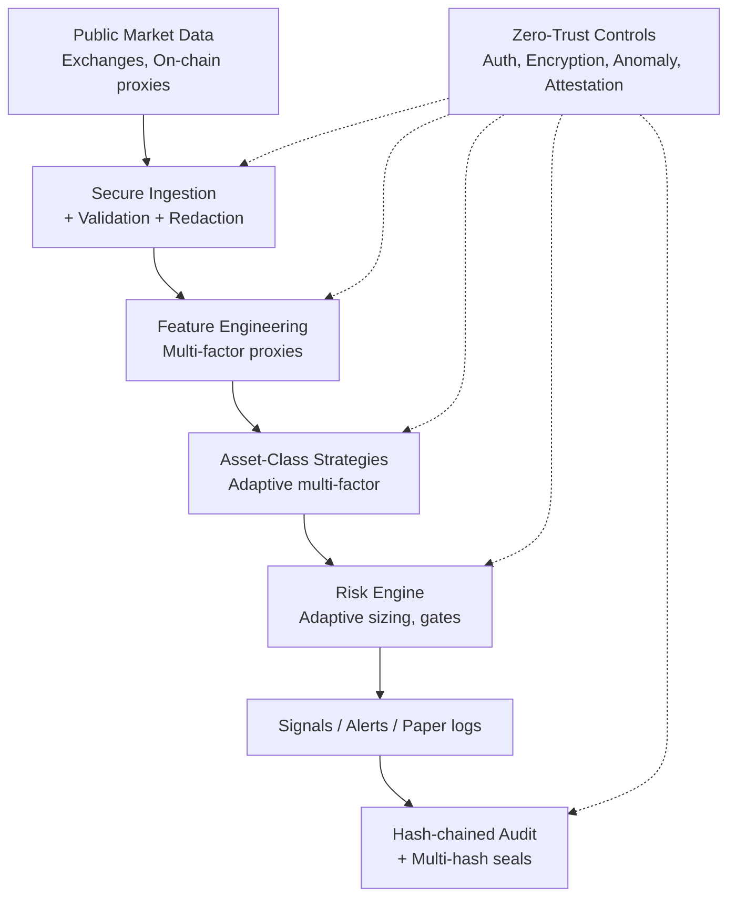

# AIxTech Enhanced Crypto Trading Information System v2

> **v2 Enhanced** paper-only automated cryptocurrency trading information system with advanced multi-factor adaptive strategies per asset class, robust zero-trust cyber and data security architecture, and AI-agent harness principles.
>
> **Research / paper-trading only.** No live order execution, no withdrawal permissions, no storage of exchange secrets. Not financial, legal, or investment advice.

[](https://github.com/kkzee92/aixtech-enhanced-crypto-trading-system-v2/actions/workflows/ci.yml)
  

## Overview
Modular framework for crypto trading *information* and paper strategy evaluation:

- **9 asset classes** with refined multi-factor adaptive strategies (Majors, Large Alts, DeFi, Stables, High-Vol, L2, RWA, Perpetuals, AI-tokens)
- Secure data ingestion (public market data only, synthetic fixtures)
- Adaptive risk management & position sizing (vol-targeting, correlation, anomaly gates)
- Zero-trust cyber/data security architecture (redaction, multi-hash seals, anomaly proxies, continuous attestation)
- AI-agent safe development (AGENTS.md, disclosure trails, CI gates inspired by [zeekiankok92/aixtech-agent-harness-demo](https://github.com/zeekiankok92/aixtech-agent-harness-demo))
- Offline-capable simulation and demo hooks

Builds on prior kkzee92 versions (v1, v0.59 series) and the AI coding-agent harness demo.

## Quick Start
```bash
python3 -m venv .venv && source .venv/bin/activate
pip install -r requirements.txt
PYTHONPATH=src python -m crypto_trading demo
PYTHONPATH=src pytest tests/ -q
```

## Architecture
See [docs/architecture.md](docs/architecture.md).



## Asset Class Strategies
| Class | Examples | Focus | Risk Cap |
|-------|----------|-------|----------|
| Majors | BTC, ETH | Adaptive EMA/ATR/Supertrend + funding/OI/vol | Medium |
| Large Alts | SOL, BNB, ADA | Relative strength + breakout + correlation filter | Medium-High |
| DeFi | UNI, AAVE, LINK | Price + TVL/fee + isolation + risk-parity | High |
| Stables | USDT, USDC | Peg deviation + volume + netflow | Low (alert) |
| High Vol | Memes, new | Strict 0.5% risk, time stops, anomaly filter | Very High |
| L2 | ARB, OP | Relative strength vs benchmark + adaptive MTF | Medium |
| RWA | Tokenized assets | Slow multi-scale + gap/anomaly halt | Low-Medium |
| Perpetuals | Perp markets | Funding carry + contained drift + OI | Medium |
| AI-tokens | FET, AGIX, etc. | Hybrid burst + activity proxy + divergence | High |

Details: [docs/trading-strategies.md](docs/trading-strategies.md)

## Security Architecture
[SECURITY.md](SECURITY.md) · [docs/security-architecture.md](docs/security-architecture.md)

- Zero Trust, least privilege, defense in depth
- Expanded redaction (keys, seeds, tokens, high-entropy, exchange formats)
- Multi-hash seals (SHA-256 + SHA3 + BLAKE2b proxies)
- Anomaly detection proxies (isolation, entropy, residual)
- Continuous verification and source attestation stubs
- Secrets via env / vault (never in code); CI gitleaks-style gate
- Encryption in transit/at rest; audit logging with hash chains
- CI: lint, tests, secret scan style, license check, PDPA-like guards

## AI Agent Rules
See [AGENTS.md](AGENTS.md). Human review required. No production secrets or personal data in prompts. Synthetic fixtures only.

## Licence
[MIT](LICENSE)
