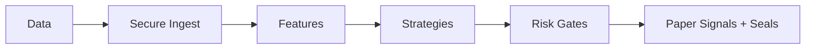

# Architecture

Modular paper-only information system:

1. **Secure Ingestion** — public data + synthetic fixtures, validation, redaction.
2. **Feature Engineering** — multi-factor proxies (EMA, ATR, volume ratios, funding, OI, TVL, relative strength, anomaly scores).
3. **Asset-Class Strategies** — 9 specialized adaptive multi-factor rules.
4. **Risk Engine** — class caps, vol-targeting, correlation/anomaly/drawdown/kill-switch gates, adaptive sizing.
5. **Audit** — hash-chained logs with multi-hash seals and continuous attestation proxies.

Zero-trust controls overlay every layer. See security-architecture.md for details.

